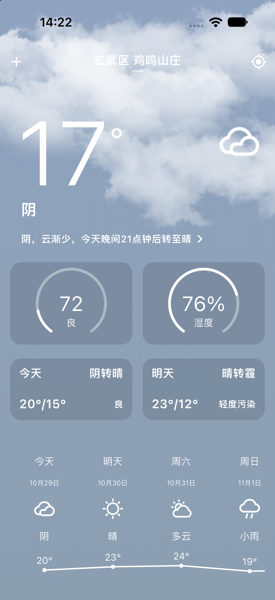
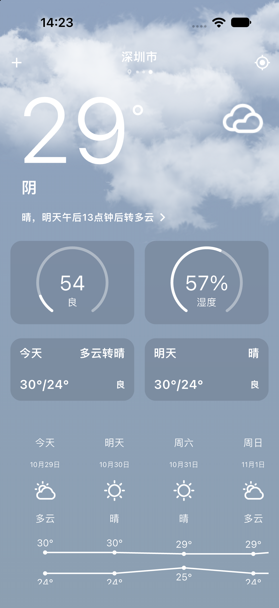
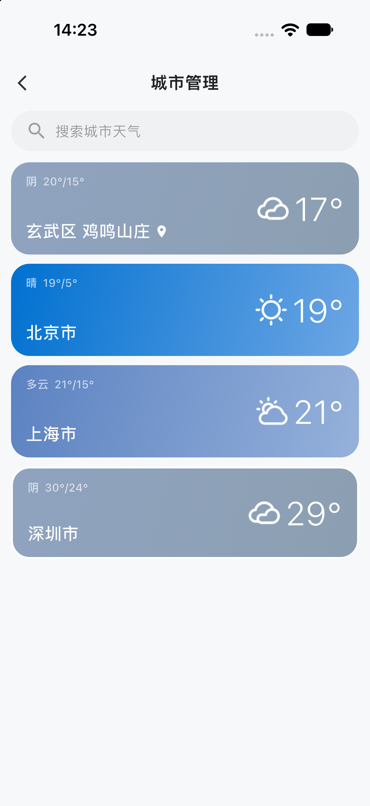

# Wade天气（weather_app）

一个以 **MVVM + Clean Architecture** 组织、使用 **BLoC** 管理状态的 Flutter 天气应用。
数据来自彩云天气，定位与逆地理编码来自高德开放平台。项目只保留一个可上下滚动的主页。

## 功能预览

以下截图来自当前版本：

<table>
  <tr>
    <td align="center" width="50%">
      
      <br />
      <strong>首页天气总览</strong><br />
      <sub>定位地名、实时温度、天气摘要、AQI、湿度、今明天气和未来趋势</sub>
    </td>
    <td align="center" width="50%">
      
      <br />
      <strong>多城市左右切换</strong><br />
      <sub>通过 PageView 切换已保存城市，缓存命中时直接展示，不重复请求</sub>
    </td>
  </tr>
  <tr>
    <td align="center" width="50%">
      
      <br />
      <strong>城市管理</strong><br />
      <sub>查看各城市天气摘要、切换城市；非定位城市支持左滑删除</sub>
    </td>
    <td align="center" width="50%">
      
      <br />
      <strong>城市搜索</strong><br />
      <sub>热门城市快捷选择，也支持关键词搜索；已添加城市会给出状态提示</sub>
    </td>
  </tr>
</table>

### 功能演示视频

<a href="UI/weather_app_video.mp4">
  
  <br />
  ▶ 点击播放完整功能演示视频（MP4，约 70 MB）
</a>

演示内容包括：启动与定位、天气主页滚动、实时指标与多天趋势、左右滑动切换城市、城市管理与搜索，以及下拉刷新当前城市天气。

## 关键功能

- **首页天气总览**：实时温度、天气现象、预报摘要、AQI、湿度、今明两天天气和未来多天趋势
- **定位与具体地名**：定位成功后通过高德逆地理编码展示区、街道等具体位置
- **多城市切换**：首页左右滑动或点击顶部圆点切换城市；有缓存直接展示，无缓存才加载网络
- **城市管理**：首页左上角 `+` 进入；展示各城市天气摘要，支持选择和左滑删除，定位城市不可删除
- **城市搜索**：提供热门城市快捷入口和高德行政区搜索，已添加城市会显示状态
- **下拉刷新**：只刷新当前城市，跳过缓存强制请求网络；失败时保留旧数据并提示
- **天气详情**：逐小时温度曲线、多天温度趋势、日出日落、体感、气压、风速、PM2.5、紫外线和生活指数
- **分钟级降水**：从预报摘要进入未来两小时降水详情
- **动态视觉**：根据天气类型切换动态背景，使用毛玻璃卡片和自定义绘制图表
- **可靠性与监控**：网络失败自动回退本地缓存；Sentry 负责未捕获错误和路由性能监控

## 架构

按 **bounded context** 拆成两个 feature：

```
lib/
├── app/                       # 应用装配：根组件、DI、路由、通用 UI
│   ├── app.dart
│   ├── di/
│   ├── router/
│   └── widgets/               # 跨 feature 通用 UI（BlurCard / SwipeDeleteCard）
├── shell/                     # 主壳：首页组合 + 顶部栏
│   └── presentation/
│       ├── pages/home_page.dart
│       └── widgets/home_top_bar.dart
├── core/                      # 基础设施：不得依赖 features
│   ├── config/
│   ├── error/
│   ├── monitoring/            # MonitoringService 抽象 + Sentry/Noop 实现
│   ├── network/
│   ├── storage/
│   ├── state/
│   ├── usecase/
│   └── utils/
└── features/
    ├── city/
    │   ├── domain/            # City / CityWeatherSummary / 仓库契约 / 端口 / 用例
    │   ├── data/              # 定位、高德搜索、城市持久化、CityRepositoryImpl
    │   └── presentation/      # CityBloc / CitySearchBloc / CityManagerBloc / 管理页 / 搜索页
    └── weather/
        ├── domain/            # Weather / WeatherRepository / 天气用例
        ├── data/              # 彩云 DTO、天气缓存、WeatherSummaryProviderImpl
        └── presentation/      # WeatherBloc / 天气图表、内容区
```

### feature 依赖方向

```
features/weather/domain      → features/city/domain        （天气需要 City）
features/weather/data        → features/city/domain        （实现 CityWeatherSummaryProvider）
features/city                → 自己的 domain/data/presentation
features/*/presentation      → app/widgets（仅通用 UI 组件）
app/shell                    → 两个 feature（负责组合与跨 feature 协调）
```

关键设计：

- `CityBloc` 是城市列表与当前城市的**唯一状态源**；
- `WeatherBloc` 只负责“给定城市 → 加载天气”；
- `HomePage` 在 app 组合层监听 `CityBloc` 的选中城市变化，再触发 `WeatherBloc`；
- 城市管理页需要天气摘要，但 **city 不反向依赖 weather**：
  - `city/domain` 声明 `CityWeatherSummaryProvider` 端口；
  - `weather/data` 的 `WeatherSummaryProviderImpl` 实现该端口；
  - DI 负责把实现注入 city 的用例。

## 状态管理

`features/city/presentation/bloc` + `features/weather/presentation/bloc`：

- `CityBloc`：`CityStarted / CityRelocated / CitySelected / CityAdded / CityRemoved`
  - 持有已保存城市、当前选中城市、定位兜底标记
- `WeatherBloc`：`WeatherRequested(City) / WeatherRefreshed`
  - 只关心天气加载，不持有城市列表
- `CitySearchBloc`：热门城市页的关键词搜索状态
- `CityManagerBloc`：批量读取城市天气摘要
- `HomePage`（shell 主壳）：监听城市选中变化，触发天气加载

所有 bloc 只依赖各自 feature 的 domain 用例，不接触 data/JSON/网络细节。

## 网络与缓存

- 所有 HTTP 请求走 `core/network/ApiClient`（Dio 实现 + 统一 `Result` / `Failure`）
- 彩云天气：`GET {CAIYUN_BASE_URL}{lng},{lat}/weather.json`
- 高德逆地理编码：`GET {AMAP_BASE_URL}/geocode/regeo`
- 天气响应原始 JSON 写入 `KeyValueStore`（SharedPreferences）
- 城市列表保存在 `weather.saved_cities`，定位城市始终排在最前且不可删除

### 性能优化

- 天气图标在首帧后并发预加载，不阻塞 `runApp`；
- CustomPainter 的文字布局结果做有上限缓存，避免每次重绘都重新排版；
- 城市管理摘要最多 3 个并发读取，兼顾速度与接口限流；
- 首页顶栏、背景、PageView 分别订阅所需状态，缩小 rebuild 范围。

### 天气加载策略

| 场景 | 行为 |
| --- | --- |
| 左右滑动 / 圆点切换城市 | 内存缓存 → 本地缓存优先，有数据直接展示，不发网络 |
| 城市列表变化 | 预读各城市本地缓存，PageView 每页可直接渲染 |
| 切换到无缓存城市 | 显示 loading，请求网络并回写缓存 |
| 下拉刷新当前城市 | `forceRefresh=true`，跳过缓存强制请求网络 |
| 下拉刷新失败 | 保留旧数据 + SnackBar 提示，不静默回退缓存 |

## 运行

```bash
# 安装依赖
flutter pub get

# 开发环境（Sentry environment=development，100% 追踪）
flutter run --dart-define-from-file=config/dev.json

# 测试环境（Sentry environment=test，100% 追踪）
flutter run --dart-define-from-file=config/qa.json

# 生产构建（Sentry environment=production，10% 追踪）
flutter build apk --release --dart-define-from-file=config/prod.json

# iOS 真机 Debug 卡住时（DDS/无线调试问题）
flutter run --debug --no-dds -d <真机ID>
```

不传 `--dart-define-from-file` 时使用 `AppConfig.fromEnvironment` 的内置默认值，也能直接运行。

## 质量门禁

```bash
dart format --output=none --set-exit-if-changed .
flutter analyze --fatal-infos
dart run tool/check_architecture.dart
flutter test
```

架构守卫会检查 R1–R8（domain 不依赖 Flutter、data 不依赖 presentation、core 不依赖 features、实体不含 JSON、单文件不超过 400 行等）。

## CI/CD

仓库使用 **GitHub Actions 调度 + Fastlane 执行构建与分发**。GitHub 工作流只负责环境、凭证和产物上传，实际构建命令统一放在 `fastlane/Fastfile`。

| 工作流 | 触发方式 | 用途 |
| --- | --- | --- |
| `mobile-ci.yml` | PR / `main` / `dev` | 格式、静态分析、架构约束、环境配置校验、测试与覆盖率 |
| `android-qa.yml` | 手动 / `main` 推送 | 构建签名的 Release APK，可选分发到 Firebase App Distribution |
| `ios-qa.yml` | 手动 / `main` 推送 | 通过 Swift Package Manager 构建 Ad Hoc IPA，可选分发到 Firebase |
| `ios-testflight.yml` | 手动 / `v*` Tag | 构建 App Store IPA，可选上传 TestFlight |

常用命令：

```bash
bundle install
bundle exec fastlane lanes
bundle exec fastlane android qa
bundle exec fastlane ios qa
bundle exec fastlane ios testflight_check
bundle exec fastlane ios beta
```

构建环境由 `BUILD_ENV=dev|qa|prod` 选择 `config/<env>.json`（分发流水线提供 `qa` / `prod` 选项）。iOS 工程使用 SPM，CI 不需要执行 `pod install`。`v*` 发布 Tag 必须与 `pubspec.yaml` 版本一致，例如 `v1.0.0`。

- Android 签名 Secrets：`ANDROID_KEYSTORE_BASE64`、`ANDROID_KEYSTORE_PASSWORD`、`ANDROID_KEY_ALIAS`、`ANDROID_KEY_PASSWORD`
- iOS 签名 Secrets：`IOS_CERTIFICATE_P12_BASE64`、`IOS_CERTIFICATE_PASSWORD`、`IOS_PROFILES_ZIP_BASE64`、`KEYCHAIN_PASSWORD`
- TestFlight 额外 Secrets：`ASC_KEY_ID`、`ASC_ISSUER_ID`、`ASC_KEY_CONTENT`，也可通过 `USE_MATCH=1` 使用 Fastlane Match
- Firebase App Distribution 与 Telegram 通知为可选配置，未配置时只构建并上传 GitHub Artifact

## Sentry 监控

通过 `core/monitoring/MonitoringService` 接入，业务层不直接依赖 Sentry：

- `SentryMonitoringService`：Sentry 实现（错误、面包屑、性能）
- `NoopMonitoringService`：关闭/测试实现
- DI 根据 `SENTRY_ENABLED` 自动选择，可随时插拔

### 环境隔离

| 配置文件 | `APP_ENV` | `SENTRY_ENVIRONMENT` | 追踪采样 | Sentry debug |
| --- | --- | --- | --- | --- |
| `config/dev.json` | `dev` | `development` | 100% | true |
| `config/qa.json` | `qa` | `test` | 100% | true |
| `config/prod.json` | `prod` | `production` | 10% | false |

### 启动保护

Sentry 初始化最多等待 **2 秒**；超时或失败会打印 `[monitoring] ...` 并继续启动 App，不阻塞首帧。

如果 iOS 真机 `flutter run --debug` 卡住，但 `--profile` 正常，通常是 DDS/无线调试连接问题：

```bash
flutter run --debug --no-dds -d <真机ID>
```

并检查 Xcode → Window → Devices and Simulators 是否启用了 **Connect via network**。

## 配置

见 `config/dev.json` / `config/qa.json` / `config/prod.json`：

| 键 | 说明 |
| --- | --- |
| `APP_ENV` | `dev` / `qa` / `prod` |
| `CAIYUN_BASE_URL` | 彩云天气根地址，必须以 `/` 结尾 |
| `AMAP_BASE_URL` | 高德 Web 服务根地址 |
| `AMAP_KEY` | 高德 Web 服务 Key |
| `ENABLE_HTTP_LOGGING` | 是否打印 HTTP 日志 |
| `SENTRY_DSN` | Sentry 项目 DSN |
| `SENTRY_ENVIRONMENT` | `development` / `test` / `production` |
| `SENTRY_ENABLED` | 是否启用 Sentry（false 走 Noop） |
| `SENTRY_DEBUG` | Sentry SDK 调试日志 |
| `SENTRY_TRACES_SAMPLE_RATE_PERCENT` | 性能追踪采样百分比（0–100） |

## 显示"当前位置"？

GPS 定位成功但高德逆地理编码失败时，首页会显示"当前位置"。

代码会优先用 `addressComponent` 拼出"区 + 街道"；为空时回退到 `formatted_address`。
如果仍然显示"当前位置"，查看控制台 `weather.geocode` 日志：

- `INVALID_USER_KEY` / `USERKEY_PLAT_NOMATCH`：高德 Key 无效或平台不匹配；
- `DAILY_QUERY_OVER_LIMIT` / `INSUFFICIENT_PRIVILEGES`：配额用尽或无权限；
- 其它网络/解析错误：检查设备网络与高德 regeo 返回。

对应配置项为 `AMAP_KEY`，可在 `config/dev.json` / `config/qa.json` / `config/prod.json` 中替换。

## 平台权限

- Android：`INTERNET`、`ACCESS_FINE_LOCATION`、`ACCESS_COARSE_LOCATION`
- iOS：`NSLocationWhenInUseUsageDescription`

定位失败时会自动使用北京作为兜底城市，并给出提示。
